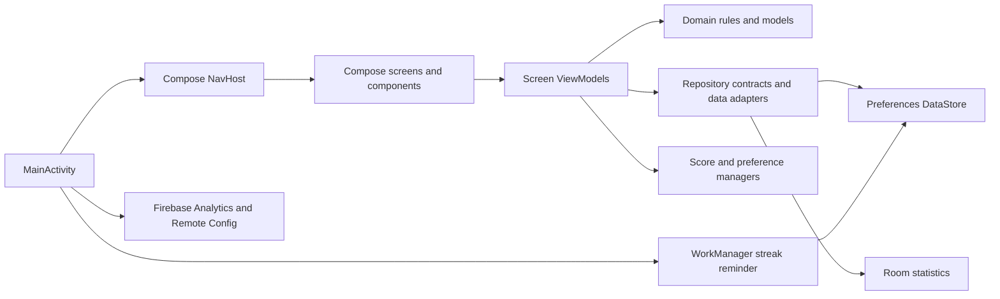

# Architecture

Sudoku is a single-module, offline-first Android game for puzzle play, guided
lessons, daily streaks, rewards, settings, and local statistics. The application
is written in Kotlin and uses Jetpack Compose with Material 3 for its interface.
Presentation code is grouped into screens, ViewModels, and reusable components;
domain packages hold game rules, models, and repository contracts; data packages
implement local persistence and integrations. Preferences DataStore stores
active game, streak, settings, and wallet state, while Room stores completed
game statistics. Firebase is used for Analytics, Crashlytics, and clue-count
Remote Config; WorkManager schedules streak reminders.

**Architecture style:** feature/presentation, domain, and data packages with
repository contracts where present. Dependencies are created with singleton
accessors and Compose `remember`; no DI framework is used.

| Component | Location | Responsibility | Key dependencies |
|---|---|---|---|
| Android entry and app shell | `SudokuApp.kt`, `presentation/ui/MainActivity.kt` | Firebase initialization, permissions, theme, startup work, Compose host | AndroidX Activity, Firebase, WorkManager |
| Navigation and screens | `presentation/navigation/`, `presentation/ui/screen/` | Compose navigation, screen UI and callbacks | Navigation Compose, lifecycle ViewModels |
| Reusable UI | `component/`, `presentation/ui/theme/` | Shared Compose widgets and Material theme | Compose Material 3 |
| Presentation state | `presentation/viewmodel/` | Screen-scoped game, settings, rewards, streak, and statistics state | Coroutines/Flow, repositories, managers |
| Domain | `domain/` | Sudoku generation, validation, models, repository contracts | Kotlin; Compose snapshot state is used by `UndoManager` |
| Local data | `data/` | DataStore managers, Room database/DAOs, repositories, score and completion handling | Preferences DataStore, Room |
| Platform integrations | `utils/` | Analytics, Remote Config, streak worker scheduling, sharing and rules | Firebase, WorkManager, Android APIs |

## Technology stack

| Concern | Current implementation |
|---|---|
| Language/runtime | Kotlin; Java 17 compatibility and Kotlin JVM 17 toolchain |
| UI | Jetpack Compose, Material 3 |
| Architecture | Screen ViewModels, domain models/rules, repository contracts and data implementations where present |
| Database | Room for completed regular and streak results |
| Key-value storage | Preferences DataStore for game, streak, settings, theme, points, and wallets |
| Networking | No app REST/GraphQL client; Firebase Remote Config is the configured remote integration |
| Dependency injection | No DI framework; singleton accessors, constructors, and Compose `remember` |
| Async | Kotlin coroutines and Flow; WorkManager for scheduled work |
| Testing | JUnit 4 unit tests; AndroidX JUnit, Espresso, and Compose UI test dependencies |
| Build | Gradle Kotlin DSL, Android Gradle Plugin, version catalog, KSP for Room |

## Cross-cutting concerns

| Concern | Evidence-based behavior |
|---|---|
| Authentication/authorization | No user account or authorization flow is present. |
| Logging/observability | Analytics goes through `AnalyticsUtils`; Crashlytics is initialized by the app. Both Analytics and Crashlytics collection are disabled in debug builds. |
| Configuration | `RemoteConfigManager` supplies clue-count defaults; debug builds use a fixed value. |
| Error handling | Repository and state APIs define local results; behavior varies by call site. Remote Config fetch exceptions are caught without surfacing a result. |
| Validation | Sudoku move/game rules are implemented in domain/util and `utils/SudokuRules.kt`; settings normalize mutually exclusive options. |

## Constraints

- `:app` is the only included Gradle module.
- SDK configuration is min 28, compile 37, target 36. Debug and release build
  types are configured; release enables code minification and resource shrinking.
- The application persists state locally. No cloud save or backend API is
  present.
- Room schema version is 1 and schema export is disabled. Review migration needs
  before changing persisted entities.
- Release packaging/publication behavior is defined in
  `.github/workflows/android-build.yml`; consult it before release changes.
