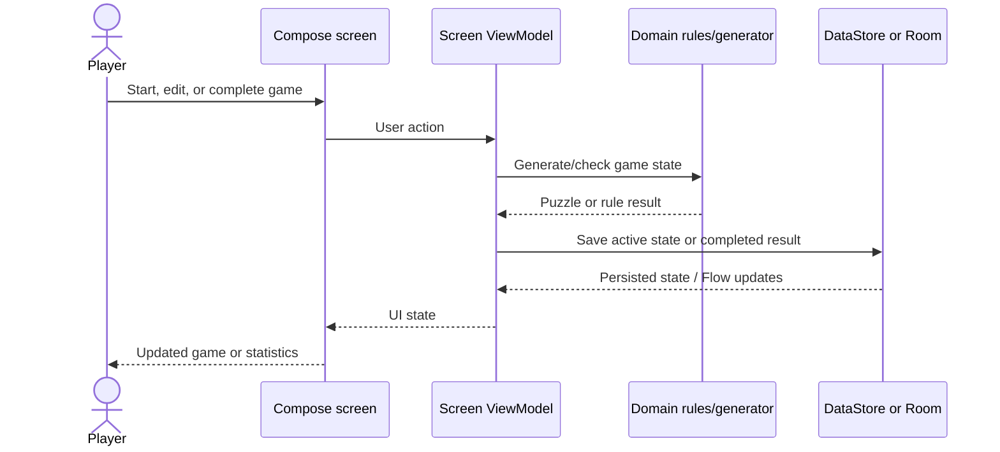

# Data flow

State is local-first. Compose screens invoke screen-scoped ViewModels; ViewModels
coordinate domain logic and persistence managers/repositories. Firebase Remote
Config is fetched at startup for clue settings, while Analytics and Crashlytics
are platform integrations rather than game-state stores.

## Workflows

| Workflow | Trigger and entry | Processing | Stores/integrations and output | Failure behavior |
|---|---|---|---|---|
| New/resumed game | Home navigation to `SudokuScreen`; state owned by `SudokuGameViewModel` | Generate through `SudokuGenerator` or restore via `GameStateManager`; apply moves/rules; save active game; record completion through completion/statistics path | Game DataStore; `TotalScoreManager`; Room regular results | Malformed `GameState` deserialization returns `null`; handling of other operation failures varies by caller |
| Streak game | Streak screen route to play screen | Load/update streak state; play using game state; record streak result separately; update streak progress | Streak DataStore and Room `streak_games`; optional wallet shield | Invalid serialized streak state returns `null`; worker/platform failures are not centrally normalized |
| Settings and rewards | Settings/Rewards screens and their ViewModels | Observe DataStore flows; update preferences and wallets; coordinate rewards and cooldown | App/theme/score DataStores; Firebase Analytics events | Preference and payout errors follow the calling operation; no API error envelope |
| Statistics | Statistics screen and `StatisticsViewModel` | `StatisticsRepository` combines DAO flows into domain statistics | Room `game_statistics` and `streak_games` | Query/collection errors are not converted to a documented common error type |
| Streak reminder | Scheduled by `StreakReminderScheduler` from `MainActivity`; `StreakReminderWorker` runs | Read saved streak date; if today's challenge is not complete, check notification permission and post reminder | WorkManager, streak DataStore, Android notification service, Analytics | Missing Android 13+ notification permission skips notification; worker returns success |
| Startup configuration | `SudokuApp` and `MainActivity` startup | Initialize Firebase/defaults; fetch/activate Remote Config; initialize/reconcile reward state in app shell | Firebase Remote Config and local DataStore | Remote Config fetch exceptions are caught without user-visible error; defaults are configured in `RemoteConfigManager` |

## Data stores

| Store | Purpose | Main entities/tables | Written by | Read by |
|---|---|---|---|---|
| Preferences DataStore (`sudoku_game_state`) | Active regular game save | Serialized `GameState` | `GameStateManager`, game flow | Game repository and `SudokuGameViewModel` |
| Preferences DataStore (`streak_state`) | Streak progress and active streak game | Serialized `StreakState` / `GameState` | `StreakStateManager`, streak flow | Streak ViewModel, game flow, reminder worker |
| Preferences DataStore (`app_preferences`) | Gameplay settings, wallet balances, migration/milestone state and spin timestamp | Preference keys, not Room entities | `AppPreferences` | Settings, Home, Rewards and game ViewModels |
| Preferences DataStore (`total_score`) | Lifetime score/points | Total score preference | `TotalScoreManager` | Home, Rewards and game/reward flows |
| Preferences DataStore (`theme_preferences`) | Dark/light theme | Theme preference | Theme preference implementation | `MainActivity` / theme |
| Room (`sudoku_database`) | Completed regular and streak game statistics | `game_statistics`, `streak_games` | `StatisticsRepository` | Statistics repository and statistics UI |

## External integrations

| Integration | Purpose | Direction | Where used |
|---|---|---|---|
| Firebase Remote Config | Clue-count configuration | App fetches configuration | `RemoteConfigManager`, app startup, generator |
| Firebase Analytics | Game, screen, settings, and notification events | App sends events | `AnalyticsUtils` |
| Firebase Crashlytics | Crash reporting | App reports crashes | `SudokuApp` initialization |
| WorkManager | Schedule daily streak reminder work | App enqueues work; worker reads local state and posts platform notification | `StreakReminderScheduler`, `StreakReminderWorker` |
| Android notification service | Display streak reminder | App posts notification | `StreakReminderWorker` |
