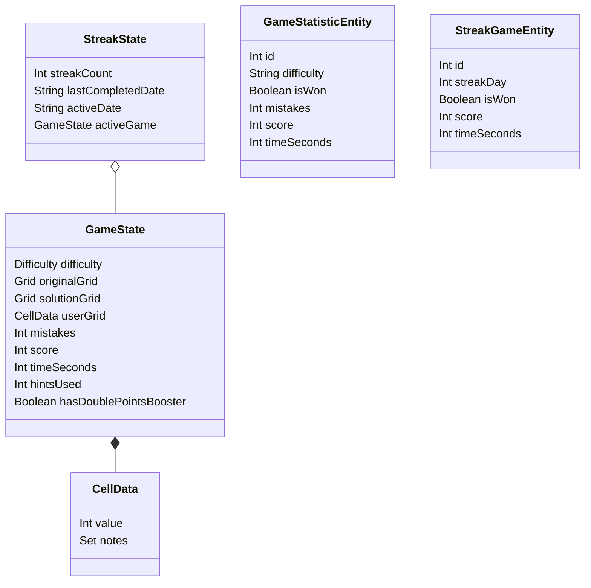

# Domain model

The app models an in-progress game separately from completed-game statistics.
Regular and streak game state use separate DataStore managers, and Room keeps
regular and streak results in separate tables. Settings and reward balances live
in Preferences DataStore.

| Entity | Purpose | Key fields | Relationships | Lifecycle/states | Invariants |
|---|---|---|---|---|---|
| `Difficulty` | Difficulty tier for play | Breeze, Pulse, Rage, Elite | Used by `GameState` and puzzle generation | Selected for a new game | Labels and clue ranges are defined in app/config |
| `GameState` | In-progress regular or streak game | Grids, wrong cells, mistakes, score, time, selection, notes mode, hints used, booster flag | Contains `CellData`; can be nested in `StreakState` | Generated, edited, serialized/restored, completed or cleared | Save format is hand-built; old saves may omit newer optional fields |
| `CellData` | User-entered cell value and notes | `value`, `notes` | Members of the user grid in `GameState` | Updated during gameplay | Notes do not replace the stored puzzle solution |
| `StreakState` | Daily streak progress and optional active game | Count, completion date, active date, active game | Has optional `GameState` | Advances on completion; may be protected/reset | Stored separately from regular game state |
| `GameStatisticEntity` | Completed regular-game result | Difficulty, outcome, mistakes, score, time, completion timestamp | Room table `game_statistics` | Inserted at completion | Separate from streak result records |
| `StreakGameEntity` | Completed streak-game result | Streak day, outcome, score, time, completion timestamp | Room table `streak_games` | Inserted at completion | Separate from regular result records |
| Wallet preferences | Persisted points-related reward balances | Hint, 2X Booster, Streak Shield and progress keys | Held by `AppPreferences`; used by Home/Rewards/game flows | Earned, consumed, migrated or reconciled | Credit paths are designed for idempotency; consumption must not go below zero |
| Gameplay settings | Persisted user options | Free Play, Hide Used Numbers, highlighting, sound/vibration | Held by `AppPreferences` | Updated from Settings | Free Play and Hide Used Numbers are mutually exclusive |

## Supported business rules

- Free Play removes mistakes and points in regular games, but is ignored in
  streak mode. It cannot be changed while a saved game exists.
- Hide Used Numbers hides a digit once all nine instances are placed.
- Each regular or streak game can use at most three Hint Wallet hints.
- A selected 2X Booster is saved with an unfinished game and consumed on a
  completed boosted game; credited points are doubled.
- A Streak Shield protects one missed calendar day without incrementing the
  streak count. Regular and streak statistics remain separate.
- Debug builds use 72 clues. Non-debug clue ranges use Firebase Remote Config
  with defaults: Breeze 46–51, Pulse 32–37, Rage 26–31, Elite 22–26.
- The Sudoku generator constructs a complete solution and removes cells; it
  does not check that the resulting puzzle has a unique solution.
- “Points” is UI terminology; code and persistence retain “score”.

## Terminology mapping

| Business term | Code representation |
|---|---|
| Points | `score` fields and `TotalScoreManager` |
| Hint Wallet | `AppPreferences.hintWallet` |
| 2X Points Booster | `doublePointsBoosterWallet` and `GameState.hasDoublePointsBooster` |
| Streak Shield | `streakShieldWallet` and streak-state recovery behavior |
| Streak game | `StreakState` plus `StreakGameEntity` |
