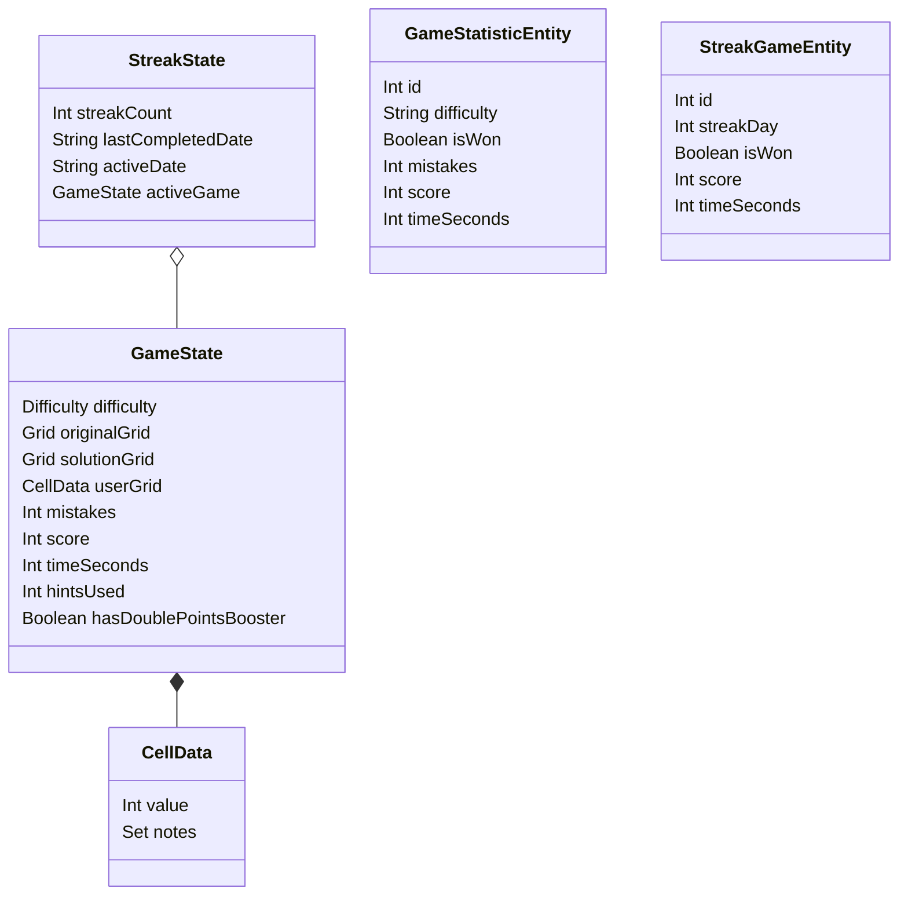

# Domain model

The app models an in-progress game separately from completed-game statistics.
Regular and streak game state use separate DataStore managers, and Room keeps
regular and streak results in separate tables. Settings and reward balances live
in Preferences DataStore.

| Entity | Purpose | Key fields | Relationships | Lifecycle/states | Invariants |
|---|---|---|---|---|---|
| `Difficulty` | Difficulty tier for play | Breeze, Pulse, Rage, Elite | Used by `GameState` and puzzle generation | Selected for a new game | Labels and clue ranges are defined in app/config |
| `GameState` | In-progress regular or streak game | Grids, wrong cells, mistakes, score, time, selection, notes mode, hints used, booster flag, scored cells | Contains `CellData`; can be nested in `StreakState` | Generated, edited, serialized/restored (regular and streak both via `SudokuGameViewModel.restoreFrom`), completed or cleared | Save format is hand-built; old saves may omit newer optional fields. `scoredCells == null` means an old save: it is inferred from the grid. Undo history is not persisted |
| `CellData` | User-entered cell value and notes | `value`, `notes` | Members of the user grid in `GameState` | Updated during gameplay | Notes do not replace the stored puzzle solution |
| `StreakState` | Daily streak progress and optional active game | Count, completion date, active date, active game | Has optional `GameState` | Advances on completion; may be protected/reset | Stored separately from regular game state |
| `GameStatisticEntity` | Completed regular-game result | Difficulty, outcome, mistakes, score, time, completion timestamp | Room table `game_statistics` | Inserted at completion | Holds every recorded game, including streak games as difficulty `"streak"`, so Overall covers all games by design. Free Play and practice games are not recorded |
| `StreakGameEntity` | Completed streak-game result | Streak day, outcome, score, time, completion timestamp | Room table `streak_games` | Inserted at completion | Feeds only the Streak stats; each streak game is also written to `game_statistics` on purpose (see `SUDOKU_KNOWLEDGE.md`) |
| Wallet preferences | Persisted points-related reward balances | Hint, 2X Booster, Streak Shield and progress keys | Held by `AppPreferences`; used by Home/Rewards/game flows | Earned, consumed, migrated or reconciled | Credit paths are designed for idempotency; consumption must not go below zero |
| Gameplay and reminder settings | Persisted user options | Free Play, Hide Used Numbers, highlighting, sound/vibration, Streak Reminders opt-in | Held by `AppPreferences` | Updated from Settings or the post-win Streak prompt | Free Play and Hide Used Numbers are independent; neither can change while a saved game exists. Streak reminders require app opt-in and Android notification access |

## Supported business rules

- Free Play removes mistakes and points in regular games, but is ignored in
  streak mode. It cannot be changed while a saved game exists.
- Hide Used Numbers hides a digit once all nine instances are placed.
- Each regular or streak game can use at most three Hint Wallet hints.
- Wallet setup grants five welcome hints, one 2X Points Booster, and one Streak
  Shield once each. The welcome reward summary is shown once on the user's first
  visit to Rewards, including when point-based migration grants are zero.
- A selected 2X Booster is saved with an unfinished game and consumed on a
  completed boosted game; credited points are doubled.
- A Streak Shield protects one missed calendar day without incrementing the
  streak count. Regular and streak statistics remain separate.
- Streak reminders are opt-in. The post-win prompt is offered at the first
  streak win and, after each decline, again every 5 streak games won until
  reminders are on; turning them off in Settings stops it for good. Settings
  can request permission again after a denial; delivery requires app opt-in
  and Android notification access.
- Statistics derive total points and average completion time from completed
  Room records; averages count won games only (like best time) and are
  unavailable when no won games have been recorded.
- Debug builds use 72 clues. Non-debug clue ranges use Firebase Remote Config
  with defaults: Breeze 46–51, Pulse 32–37, Rage 26–31, Elite 22–26.
- The Sudoku generator constructs a complete solution and removes cells; it
  does not check that the resulting puzzle has a unique solution.
- “Points” is UI terminology; code and persistence retain “score”.

## Terminology mapping

| Business term | Code representation |
|---|---|
| Points | `score` fields and `TotalScoreManager` |
| Hint Wallet | `AppPreferences.hintWallet` |
| 2X Points Booster | `doublePointsBoosterWallet` and `GameState.hasDoublePointsBooster` |
| Streak Shield | `streakShieldWallet` and streak-state recovery behavior |
| Streak game | `StreakState` plus `StreakGameEntity` |
